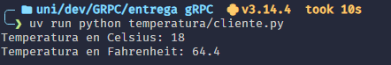
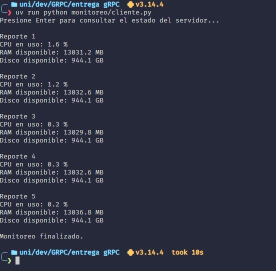

# Trabajo práctico gRPC

Desde esta carpeta, instalar las dependencias con [uv](https://docs.astral.sh/uv/):

```bash
uv sync
```

## Conversor de temperaturas

En una terminal, iniciar el servidor:

```bash
uv run python temperatura/servidor.py
```

En otra terminal, ejecutar el cliente:

```bash
uv run python temperatura/cliente.py
```



## Monitoreo del servidor

En una terminal, iniciar el servidor:

```bash
uv run python monitoreo/servidor.py
```

En otra terminal, ejecutar el cliente y presionar Enter:

```bash
uv run python monitoreo/cliente.py
```



Para detener los servidores, usar `Ctrl+C` en sus terminales.
